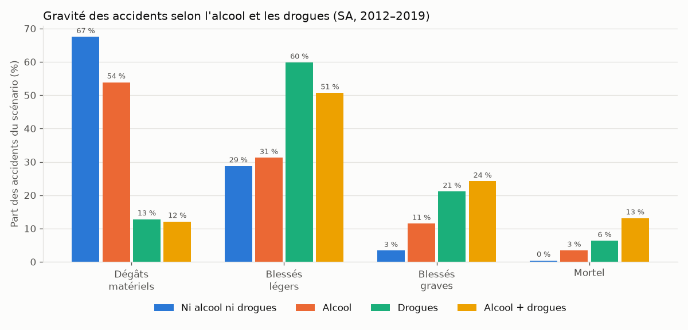
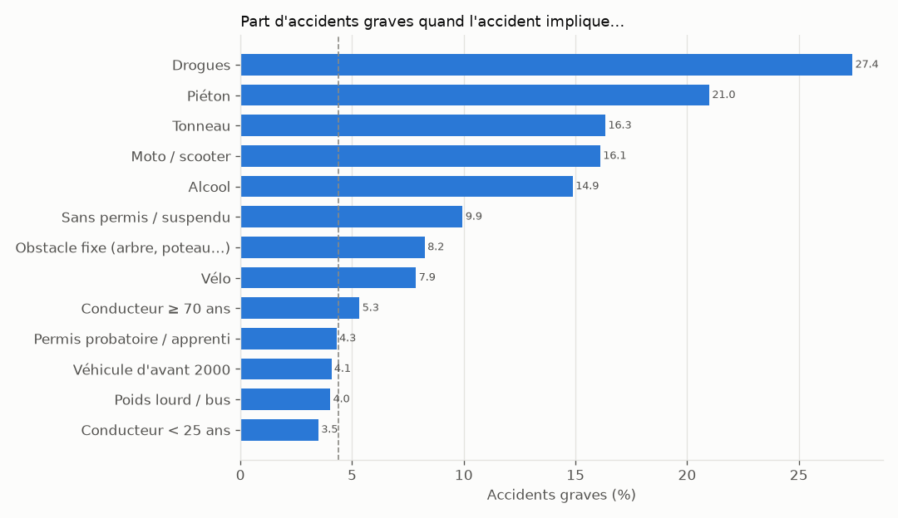

# TP2 — Accidents de la route avec PySpark

Notebook : [`TP2_accidents_route_pyspark.ipynb`](TP2_accidents_route_pyspark.ipynb) (exécuté, sorties incluses)

## Contenu

**Partie I — Reproduction** de l'article Medium
[*Big data Analysis of Road Crash Data using PySpark with PySpark Tutorial*](https://medium.com/rakesh-nain/big-data-analysis-of-road-crash-data-using-pyspark-with-pyspark-tutorial-c78ff2c35588)
(Rakesh Nain, 2021), sur les accidents de la route d'Australie-Méridionale 2012–2019
(127 672 accidents, 272 591 unités impliquées, source : DPTI / [data.sa.gov.au](https://data.sa.gov.au)) :

- RDD : `parallelize`, `textFile`, partitionnement personnalisé (`partitionBy`), requêtes `groupByKey` et `sortByKey` ;
- DataFrame : filtres, tris, agrégations, jointure accidents ⨝ unités ;
- gravité des accidents selon l'alcool et les drogues (UDF, `toPandas`, graphiques) ;
- les mêmes requêtes écrites en RDD, DataFrame et SparkSQL ;
- **corrections** des bugs trouvés dans le code de l'article (section 10 du notebook).

**Partie II — Analyse personnelle : qu'est-ce qui rend un accident grave ?**

- table « un accident = une ligne » enrichie d'indicateurs agrégés depuis les unités (moto, piéton, vélo, poids lourd,
  âge du conducteur, permis…) ;
- taux d'accidents graves (blessé grave ou mort) selon l'heure, le jour, la vitesse autorisée, les usagers impliqués et
  les conditions de route ;
- pipeline Spark MLlib (`StringIndexer` → `OneHotEncoder` → `VectorAssembler`) avec régression logistique et forêt
  aléatoire pondérées (classes déséquilibrées), évaluées par AUC ROC / AUC PR, puis interprétées.

Chaque section est précédée d'une étiquette `## [Étape]` : Configuration, Data, EDA, Prétraitement, Transformation, ML,
Éval, Conclusion.

## Résultats principaux

**Reproduction.** Le notebook s'exécute de bout en bout (~11 min), et tous les résultats publiés dans l'article sont
retrouvés à l'identique : 2 partitions de 218 366 / 54 225 unités, âge moyen de 40,8 ans pour les hommes et de
40,08 ans pour les femmes, 781 morts dont 245 contre un obstacle fixe, tables de gravité selon l'alcool et les drogues,
43 victimes des conducteurs sans permis à Adélaïde.

**Bugs trouvés dans le code de l'article**, et corrigés dans la section 10 :

| Problème | Effet | Correction |
|---|---|---|
| `line.split(',')` sur des lignes CSV dont des champs contiennent des virgules | 16,7 % des accidents (21 379) ont leurs colonnes décalées dans les requêtes RDD | découpage avec le module `csv` |
| Index de colonnes décalés d'un cran dans la requête RDD « Adélaïde » | âge au lieu du sexe, état du permis au lieu de l'âge, morts au lieu des victimes… | index calculés depuis l'en-tête |
| Requête « victimes des conducteurs **sans** permis » en trois API | filtre en réalité les conducteurs **avec** permis, et somme ≠ comptage selon l'API | `Licence Type == 'Unlicenced'` et somme : les trois API donnent le même résultat |

**Analyse personnelle.** 4,4 % des accidents sont graves (blessé grave ou mort). Le taux de gravité :

- est multiplié par 5 entre les zones à 50–60 km/h (~3 %) et les routes à 100–110 km/h (> 14 %), et par 3,8 à la
  campagne par rapport à la métropole ;
- vaut 21 % quand un piéton est impliqué, 16 % pour une moto, 27 % avec des drogues et 15 % avec de l'alcool ;
- double la nuit (7–9,5 % entre minuit et 5 h), alors que les accidents sont surtout nombreux aux heures de pointe ;
- n'augmente pas avec les jeunes conducteurs, qui ont beaucoup d'accidents, mais surtout matériels.

Une régression logistique Spark MLlib atteint une **AUC ROC de 0,86** (AUC PR 0,26 contre 0,045 pour le hasard) et
détecte 77 % des accidents graves. Ses plus forts effets à circonstances égales : piéton (cote ×10,6), vélo (×8,8),
moto (×8,6), drogues (×5,7) et choc frontal (×4,3).




## Reproduire

Prérequis : Python 3.12, un JDK 17 ou 21 et les paquets Python :

```bash
pip install pyspark pandas matplotlib numpy jupyter
```

Depuis le dossier `TP2/`, lancer Jupyter et exécuter le notebook de haut en bas, ou bien :

```bash
jupyter nbconvert --to notebook --execute --inplace TP2_accidents_route_pyspark.ipynb
```

Les données (~85 Mo) sont téléchargées automatiquement dans `TP2/data/` à la première exécution, depuis le
[dépôt GitHub de l'auteur](https://github.com/RakeshNain/Big-data-Analysis-of-Road-Crash-Data-using-PySpark-with-PySpark-Tutorial).
Le dossier `data/` est ignoré par git. Les graphiques sont enregistrés dans [`figures/`](figures/).

### Notes Windows

Le notebook tourne tel quel sous Windows, sans `winutils.exe` ni `hadoop.dll`, grâce à des contournements décrits
dans le notebook :

1. les CSV sont passés à Spark sous forme de **liste explicite de fichiers** plutôt que par le motif `dossier/*.csv`,
   car Hadoop ne sait pas lister un dossier local sous Windows sans `hadoop.dll` ;
2. `RDD.take()` / `first()` est remplacé par une version qui consomme la partition en entier, car le worker Python
   « plante » sinon sous Windows avec PySpark 4.x. Ce correctif n'est appliqué que si `os.name == "nt"` ;
3. les workers Python meurent parfois pendant les jointures RDD (de façon intermittente) : le master
   `local[*,4]` autorise Spark à **recalculer** une tâche échouée jusqu'à 4 fois, au lieu d'un seul essai par défaut
   en local. Lors de l'exécution finale, 4 tâches ont été recalculées ainsi, sans effet sur les résultats ;
4. mémoire : `spark.driver.memory = 2g` et `spark.python.worker.memory = 256m`. Prévoir quelques Go de RAM libres :
   une exécution a été tuée par manque de mémoire quand d'autres applications étaient ouvertes.

## Environnement d'exécution

Windows 11, Python 3.12.15, PySpark 4.2.0, OpenJDK 21 (Temurin), pandas 3.0, matplotlib 3.11, Spark en mode
`local[*]` (8 cœurs logiques).

## Structure

```
TP2/
├── README.md
├── TP2_accidents_route_pyspark.ipynb   notebook exécuté
├── figures/                            graphiques produits par le notebook
└── data/                               données téléchargées (ignoré par git)
```
