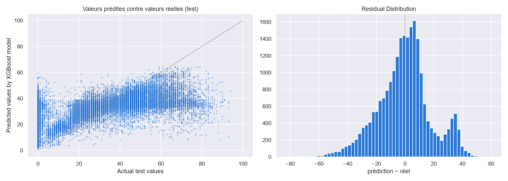
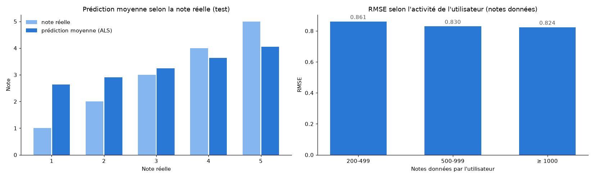

# TP3 — Deux études de cas : Small data et Big data (streaming)

Enzo Caramella — identifiant 24021136

Deux études sur le **streaming**, chacune partant d'un notebook publié sur Kaggle et suivant son cycle de travail :

| | [`Small/`](Small/) — Data classique | [`Big/`](Big/) — Big Data |
|---|---|---|
| **Sujet** | Prédire la **popularité d'un morceau Spotify** à partir de son genre et de ses caractéristiques audio | **Recommander des films Netflix** à partir de 100 millions de notes |
| **Notebook du TP** | [`TP3_small_popularite_spotify.ipynb`](Small/TP3_small_popularite_spotify.ipynb) | [`TP3_big_recommandation_netflix_spark.ipynb`](Big/TP3_big_recommandation_netflix_spark.ipynb) |
| **Notebook Kaggle de départ** | [Popularity Prediction XGBoost & Regression Analysis — Hossein Faridnasr](https://www.kaggle.com/code/hosseinfaridnasr/popularity-prediction-xgboost-regression-analysis) | [Netflix - Movie recommendation — DLao (laowingkin)](https://www.kaggle.com/code/laowingkin/netflix-movie-recommendation), 3 400 votes, le plus voté du jeu |
| **Jeu de données** | [Spotify Tracks Dataset](https://www.kaggle.com/datasets/maharshipandya/-spotify-tracks-dataset) : 114 000 morceaux, 114 genres, 20 Mo | [Netflix Prize data](https://www.kaggle.com/datasets/netflix-inc/netflix-prize-data) : 100 480 507 notes, 480 189 abonnés, 17 770 films, 2 Go |
| **Outils** | pandas, scikit-learn, XGBoost, puis PySpark (Spark SQL et Spark ML) | Spark DataFrames, Spark SQL, Spark MLlib (ALS), numpy pour le service |
| **Cycle** | Data → EDA → Prétraitement → Transformation → ML → Éval → Déploiement | Spark (Data → EDA → Prétraitement) → Transformation → ML → Éval → Déploiement |

## Organisation

```text
TP3_ID24021136/
├── README.md
├── Small/
│   ├── TP3_small_popularite_spotify.ipynb
│   ├── spotify_tracks_dataset/
│   │   └── dataset.csv                         jeu complet (20 Mo)
│   ├── artefacts/
│   │   ├── modele_popularite.joblib            pipeline scikit-learn (one-hot + XGBoost)
│   │   ├── config.json, metriques_test.json
│   │   ├── eda.png, evaluation.png
│   │   └── exemple_entree.csv, predictions.csv
│   └── requirements.txt
└── Big/
    ├── TP3_big_recommandation_netflix_spark.ipynb
    ├── netflix_prize_dataset/
    │   ├── combined_data_part01…07.txt.gz      100 M de notes brutes, 7 morceaux < 100 Mo
    │   └── movie_titles.csv
    ├── artefacts/
    │   ├── modele_als_facteurs.npz             facteurs ALS (utilisateurs, films)
    │   ├── films.csv, config.json, metriques_test.json
    │   ├── eda.png, evaluation.png
    │   └── exemple_entree.csv, predictions.csv
    └── requirements.txt
```

Chaque notebook commence par une cellule **titre + contribution** : il indique s'il s'exécute de bout en bout, liste les
problèmes rencontrés et les modifications apportées. Ses sections portent le nom des étapes du cycle (`## [Data]`,
`## [EDA]`… `## [Déploiement]`). Le code repris du notebook Kaggle est signalé par **(origine)** et les modifications
par `# [MODIF]`. L'organisation s'inspire du [TP3 d'Alex Abdallah](https://github.com/alex-abdallah/bigData/tree/main/TP3).

## `Small/` — Popularité des morceaux Spotify

La cible est `popularity` (0 à 100), un score que Spotify calcule surtout à partir des écoutes récentes.

| Étape | Ce que fait le notebook |
|---|---|
| **Data** | Charge les 114 000 lignes et montre que 21 % sont des **doublons** : le même morceau classé dans plusieurs genres (*Baby Blue* de Badfinger apparaît dans 9 genres). |
| **EDA** | Distribution de la popularité (14 % de zéros), popularité moyenne par genre (de 2 à 59), corrélations. |
| **Prétraitement** | Encodage du notebook d'origine, puis prétraitement corrigé : lignes incomplètes retirées, genre en *one-hot*. |
| **Transformation** | Découpage d'origine (lignes au hasard) **et** découpage corrigé **par morceau** (`GroupShuffleSplit`), dans un `Pipeline`. |
| **ML** | Les 9 modèles du notebook d'origine, puis les mêmes familles avec le protocole corrigé et une référence naïve. |
| **Éval** | Effet de la fuite de données, prédictions contre valeurs réelles, résidus, importance des variables. |
| **PySpark** | Les mêmes étapes avec Spark : lecture, Spark SQL, découpage par morceau, régression linéaire, forêt aléatoire et GBT Spark ML. |
| **Déploiement** | Le pipeline est sauvegardé (`joblib`) avec sa configuration, rechargé, puis appliqué à un CSV d'exemple. |

**Résultats sur 22 861 lignes de morceaux jamais vus.**

| Modèle | R² | MAE (points) |
|---|---|---|
| Référence (moyenne) | 0,00 | 18,9 |
| Régression linéaire (genre en *one-hot*) | 0,26 | 14,2 |
| **XGBoost** (scikit-learn) | **0,32** | 14,0 |
| **GBT** (Spark ML) | **0,32** | 13,6 |

Le notebook d'origine annonçait **R² = 0,47** pour XGBoost, mais ce score venait d'une **fuite de données** : 31 % des
lignes de test avaient une copie de leur morceau dans l'apprentissage. Le genre porte 99 % de l'importance : le son
seul prédit mal le succès.



## `Big/` — Recommandation de films Netflix avec Spark

Le notebook d'origine, écrit en pandas et *surprise*, ne chargeait qu'**un fichier sur quatre** faute de mémoire. Ici,
les **100 millions de notes** passent par Spark, sur un portable et avec 3 Go pour le driver Spark.

| Étape | Ce que fait le notebook |
|---|---|
| **Data** (Spark) | Lit le format brut (l'identifiant du film en en-tête de chaque bloc) depuis 7 morceaux gzip, et rattache les 100 480 507 notes à leur film grâce à une fenêtre Spark, en 3,6 min. |
| **EDA** (Spark) | Notes plutôt positives (57 % de 4 et 5, moyenne 3,60), explosion de l'activité à partir de 2004, matrice remplie à 1,2 %, longue traîne des films et des utilisateurs. |
| **Prétraitement** (Spark) | Aucune valeur manquante ni doublon. Filtrage au 70e centile, la règle de l'auteur : 30 % des films et des utilisateurs sont gardés, soit 71 % des notes. |
| **Transformation** | Périmètre du notebook d'origine (films du premier fichier, 17,3 M de notes), découpage 80 / 10 / 10, biais utilisateur et film régularisés. |
| **ML** | Deux références (moyenne, biais), puis ALS de Spark MLlib, avec le rang et la régularisation choisis sur la validation. |
| **Éval** | RMSE et MAE, erreur selon la note réelle et selon l'activité, recommandations pour l'utilisateur 785314, films similaires par cosinus. |
| **Déploiement** | Facteurs ALS exportés en numpy, rechargés **sans Spark** pour servir un CSV d'utilisateurs (repli sur les films populaires pour les inconnus). Même top 10 que Spark. |

**Résultats sur 1,73 million de notes de test.**

| Modèle | RMSE | MAE (étoiles) |
|---|---|---|
| Référence (moyenne globale) | 1,061 | 0,89 |
| Biais (μ + b_u + b_i) | 0,912 | 0,72 |
| **ALS** (rang 10, λ = 0,05) | **0,841** | **0,66** |

ALS fait 21 % de mieux que la moyenne. Les vecteurs de films regroupent des œuvres proches **sans connaître leur
genre** : les voisins de *X2* sont *Batman Begins*, *Smallville* ou *Spider-Man*. Il reste des limites : ALS n'apprend
que sur le premier fichier, les utilisateurs occasionnels sont exclus, et le découpage est aléatoire plutôt que
temporel.



## Installation et exécution

Prérequis : **Python 3.12** et, pour Spark, **Java 17 ou 21**. Depuis le dossier `TP3_ID24021136/` :

```bash
python -m venv .venv
.venv/Scripts/python -m pip install -r Small/requirements.txt -r Big/requirements.txt   # Linux/macOS : .venv/bin/python
cd Small && ../.venv/Scripts/python -m nbconvert --to notebook --execute --inplace TP3_small_popularite_spotify.ipynb
cd ../Big && ../.venv/Scripts/python -m nbconvert --to notebook --execute --inplace --ExecutePreprocessor.timeout=5400 TP3_big_recommandation_netflix_spark.ipynb
```

Les notebooks se lancent **depuis leur propre dossier** : leurs chemins sont relatifs. Toutes les données sont incluses
dans le dépôt, sans téléchargement supplémentaire. Les données Netflix sont découpées en morceaux `.txt.gz` que Spark
lit directement.

**Ressources** : par défaut, le notebook Big utilise 3 Go pour le driver Spark (variable `TP3_SPARK_MEMORY`) et
4 threads (`TP3_SPARK_MASTER`, par défaut `local[4,4]`). Les tables de 100 millions de lignes sont mises en cache sur
disque. Prévoir environ 6 Go de RAM libre et 5 Go d'espace disque temporaire. Il a été exécuté sous Windows 11, sur 8 cœurs avec 16 Go de RAM, sans
`winutils.exe`. Toutes les opérations Spark restent dans la JVM (pas d'UDF Python), et la sauvegarde native d'un modèle
Spark, qui exige `winutils.exe` sous Windows, est remplacée par un export numpy (voir la section Déploiement du
notebook Big).
